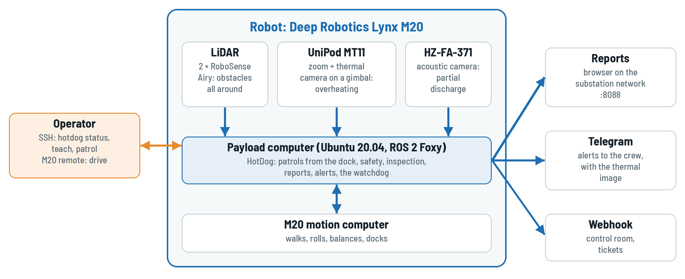

<div align="center">


# HotDog

**Autonomous substation patrol robot on the Deep Robotics Lynx M20: teach and repeat on the
robot's own odometry, thermal overheat analysis with the UniPod MT11 and partial discharge
detection with the Hertzinno HZ-FA-371 at every stop point, a watchdog that brings it home,
reports in the browser and alerts on Telegram. Built on the Dharma stack.**

[](https://github.com/DarmawanRobotics/HotDog/actions/workflows/ci.yml)
[](https://darmawanrobotics.github.io/HotDog/)
[](https://docs.ros.org/en/foxy/)
[](https://releases.ubuntu.com/20.04/)
[](dharma.repos)
[](compose.yaml)
[](LICENSE)

</div>

---

Substation (gardu induk) equipment is inspected on fixed rounds: the same disconnectors,
busbar joints, bushings and cable terminations, every shift. HotDog walks such a round on its
own, stops in front of each piece of equipment, points the pod at it and checks it for
overheating and partial discharge.

HotDog runs on **Dharma**, the shared autonomy stack, pinned in [dharma.repos](dharma.repos),
with the M20's own odometry instead of a LiDAR-inertial estimator and without maps: routes are
taught and repeated from the dock. The robot, its LiDARs and their drivers come from
[external.repos](external.repos).

**Docs: [darmawanrobotics.github.io/HotDog](https://darmawanrobotics.github.io/HotDog/)**, with
the [User Manual](docs/HotDog-User-Manual.pdf) for operators, the
[Technician Guide](docs/HotDog-Technician-Guide.pdf) for tuning and maintenance and the
[Site Acceptance Test](docs/HotDog-Site-Acceptance-Test.pdf) for the handover, also as A5 PDFs.
More in [docs](docs/README.md).



## Packages

| Package                                                                                                                                                                                                                        | Role                                                                                                        |
| ------------------------------------------------------------------------------------------------------------------------------------------------------------------------------------------------------------------------------ | ----------------------------------------------------------------------------------------------------------- |
| [`hotdog`](src/hotdog)                                                                                                                                                                                                         | the robot: profile, M20 driver settings, stack config, `robot.launch.py`, `sim.launch.py`                   |
| [`hotdog_base`](src/hotdog_base)                                                                                                                                                                                               | both RoboSense Airy as one leveled cloud in `base_link`, the shared launch helpers                          |
| [`hotdog_inspection`](src/hotdog_inspection)                                                                                                                                                                                   | inspection at the stop points: overheat (UniPod MT11), partial discharge (HZ-FA-371), reports, teaching     |
| [`hotdog_patrol`](src/hotdog_patrol)                                                                                                                                                                                           | patrols from the dock, on demand or on a schedule, the watchdog, the way back to the dock, patrol summaries |
| [`hotdog_reports`](src/hotdog_reports)                                                                                                                                                                                         | HTML patrol reports with the last round of every finding, retention, the report server on port 8088         |
| [`hotdog_alerts`](src/hotdog_alerts)                                                                                                                                                                                           | findings, patrols and health ERROR to Telegram (English or Bahasa Indonesia) and a webhook, spooled offline |
| [`hotdog_interfaces`](src/hotdog_interfaces)                                                                                                                                                                                   | findings, inspection reports and status, `AddTarget`                                                        |
| `dharma_*` ([dharma.repos](dharma.repos))                                                                                                                                                                                      | odometry monitor, localization, perception, routes, navigation, control mux, health                         |
| [m20_ros2](https://github.com/DarmawanRobotics/m20_ros2), [unipod_driver](https://github.com/DarmawanRobotics/unipod_driver), [rslidar_sdk](https://github.com/RoboSense-LiDAR/rslidar_sdk) ([external.repos](external.repos)) | M20 driver and URDF, the pod driver, the Airy driver                                                        |

<details>
<summary><b>Hardware</b></summary>

| Component  | Model                                           | Role                                                 |
| ---------- | ----------------------------------------------- | ---------------------------------------------------- |
| Robot base | Deep Robotics **Lynx M20** (wheel-legged)       | odometry, IMU, battery, motion (UDP protocol V1.3.0) |
| LiDAR      | 2 × RoboSense **Airy** (front, rear), 96 beams  | obstacle sectors, the 360° protective field          |
| Pod        | Reebot **UniPod MT11** (zoom + thermal, gimbal) | overheat analysis, evidence images                   |
| Acoustic   | Hertzinno **HZ-FA-371** acoustic camera         | partial discharge (corona, surface, floating)        |
| Compute    | payload computer, Ubuntu 20.04 + ROS 2 Foxy     | the whole stack                                      |

</details>

## Architecture

```
                 ┌────────────────────────────────────────────────────────────────────┐
 HotDog          │ patrol_node: dock -> route -> dock, schedule, watchdog, way back   │
                 │ inspection_node: overheat (UniPod MT11), partial discharge (HZ-FA) │
                 │ report_node: pages on :8088 · alert_node: Telegram, webhook        │
                 ├────────────────────────────────────────────────────────────────────┤
 Dharma          │ path follower (stop points -> inspection hook) · avoidance         │
                 │ sites and taught routes · localization (dock = map origin)         │
                 │ sector scans · control mux (only cmd_vel, e-stop, field) · health  │
                 ├────────────────────────────────────────────────────────────────────┤
 robot           │ m20_driver: odometry camera_init -> body, IMU, battery, cmd_vel    │
                 │ cloud_merger_node: front + rear Airy -> /lidar/points              │
                 │ unipod_driver: gimbal, zoom, streams, temperatures                 │
                 └────────────────────────────────────────────────────────────────────┘
```

- **Odometry only.** The M20's own dead reckoning is the odometry, nothing is mapped; the dock
  is the origin of the map frame, re-anchored before every patrol. Routes and inspection points
  are taught from the dock and repeated from it.
- **Motion has one way out.** The control mux is the only publisher of `/m20/cmd_vel`; the
  protective field on the 360° scan of both Airy, the health speed limit and the latched e-stop
  apply to every source. m20_driver stops on its own without fresh commands.
- **Inspection never holds the patrol.** The follower calls `inspection/inspect` at each stop
  point; a stop without an inspection point, a missing pod or camera answers and the robot
  moves on; everything found is in the reports.

## Quick start

```bash
git clone git@github.com:DarmawanRobotics/HotDog.git && cd HotDog
scripts/dev.sh up                     # dev container (ROS 2 Foxy, VNC): imports the repos
scripts/dev.sh build && scripts/dev.sh test
scripts/dev.sh shell
ros2 launch hotdog sim.launch.py rviz:=true          # the stack on dharma_sim, no robot
```

## Install on the robot

Ubuntu 20.04 with ROS 2 Foxy on the payload computer, its SSH key on GitHub with read access to
the `dharma_*` repositories:

```bash
git clone git@github.com:DarmawanRobotics/HotDog.git ~/dev/HotDog && cd ~/dev/HotDog
scripts/setup.sh install                 # tools, repos, rosdep, build, the hotdog command
scripts/setup.sh install service timesync   # /etc/hotdog/hotdog.env, systemd unit, chrony
sudoedit /etc/hotdog/hotdog.env          # ROBOT_IP, SITE, PARAMS_FILE, POD_IP, HERTZINO_PASSWORD,
                                         # TELEGRAM_BOT_TOKEN
sudo systemctl start hotdog && journalctl -fu hotdog
scripts/setup.sh                         # every line ok?
```

The first time on a robot or a site: [docs/commissioning.md](docs/commissioning.md) (network,
M20 calibration, LiDARs, pod, acoustic camera, alerts, time), then the
[Site Acceptance Test](docs/HotDog-Site-Acceptance-Test.pdf).

## Operate

On the robot computer, the `hotdog` command ([scripts/hotdog.sh](scripts/hotdog.sh)):

```bash
hotdog status                                   # the robot at a glance
hotdog stand && hotdog teach start              # teach from the dock, drive with the M20 remote
hotdog teach point                              # a stop point at each piece of equipment
hotdog aim 35 -10 4                             # point the pod: yaw, pitch (deg), zoom
hotdog teach target bay1_ds_clamps strips=3 acoustic   # what it sees there
hotdog teach stop && hotdog dock
hotdog patrol                                   # the route patrolled last (or name one)
hotdog schedule on                              # times and route: patrol_node in the site file
hotdog return                                   # back to the dock along the route
hotdog estop                                    # latched, until `hotdog release`
```

Reports: `http://<robot>:8088/`. Alerts: the crew's Telegram group. Day to day: the
[User Manual](docs/HotDog-User-Manual.pdf) and [docs/operations.md](docs/operations.md).

## Develop

```
HotDog/
├── .github/workflows/ci.yml   lint, scripts, Foxy build and tests (dharma.repos + external.repos)
├── .devcontainer/ compose.yaml docker/   dev container (Foxy, VNC)
├── docs/                      guides (PDF + the VitePress site), commissioning, operations
├── dharma.repos external.repos   the stack and the robot's drivers (vcstool)
├── scripts/                   setup.sh (robot), dev.sh (container), start_tmux.sh, timesync.sh
└── src/
    ├── hotdog hotdog_*        the product packages
    ├── dharma/                imported from dharma.repos (git-ignored)
    └── robots/ drivers/ external/   imported from external.repos (git-ignored)
```

`colcon test` runs the style check and the unit and in-process ROS tests of every package.
Branch, commit and code rules are in [CONTRIBUTING.md](CONTRIBUTING.md), changes in
[CHANGELOG.md](CHANGELOG.md).

HotDog is released under the [Apache License 2.0](LICENSE).
