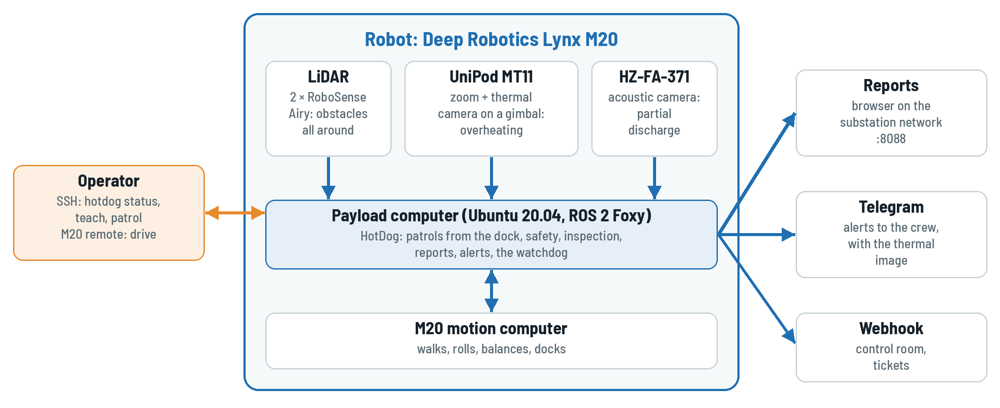

<figure class="home-shot">
  
  <figcaption>The Lynx M20 with its LiDARs, pod and acoustic camera; the payload computer runs Dharma and HotDog.</figcaption>
</figure>

  

    <h3>User Manual</h3>
    
For operators: safety in the substation, teaching routes and targets, patrols, results and alerts. No robotics needed.

    
<a href="./manual/user-manual">Read</a><a href="./HotDog-User-Manual.pdf" target="_blank">PDF</a>

  

  

    <h3>Technician Guide</h3>
    
For technicians: configuration layers, the M20, LiDARs and the protective field, inspection limits, maintenance, every parameter.

    
<a href="./technician/technician-guide">Read</a><a href="./HotDog-Technician-Guide.pdf" target="_blank">PDF</a>

  

  

    <h3>Site Acceptance Test</h3>
    
For the handover at a substation: safety functions, navigation, inspection, reports and alerts, resilience, sign-off.

    
<a href="./acceptance/acceptance-test">Read</a><a href="./HotDog-Site-Acceptance-Test.pdf" target="_blank">PDF</a>

  

