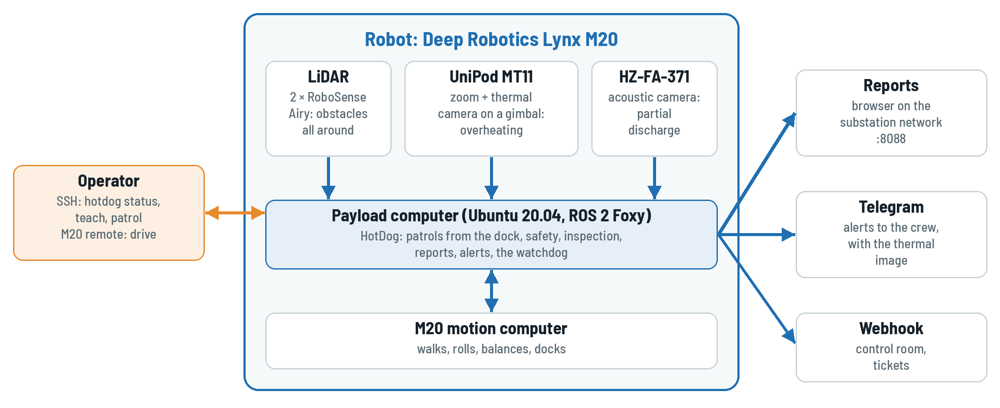
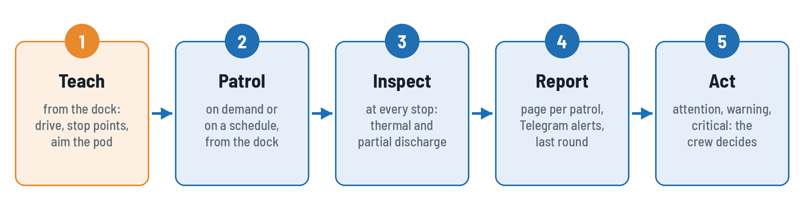
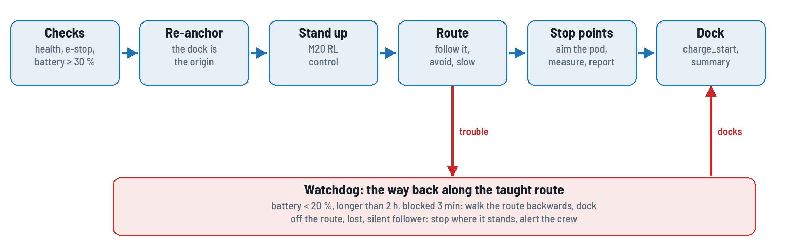

# Safety first

HotDog walks among energized high-voltage equipment. Read this chapter before you use the
robot for the first time, and follow it on every shift.

## The substation's rules come first

- HotDog works under the substation's safety rules and permits. Only people trained on this
  manual and authorized by the substation operate it; one of them is responsible for the robot
  during every patrol, including scheduled ones.
- **Safe distances.** The robot, the pod on top of it and anything it carries must stay outside
  the minimum approach distance of every energized part, for that voltage level, as the
  substation's rules set it. Teach routes only along walkways and roads that people may use
  when the equipment is energized. HotDog does not know where live parts are: the route is the
  only thing that keeps it away from them.
- **Switching and maintenance.** No patrol through a bay under switching or maintenance. Stop
  the schedule (`hotdog schedule off`) and keep the robot on its dock while work is going on.
- **Weather.** No patrols in a thunderstorm. Check the M20's protection rating in its manual
  before patrolling in rain. HotDog does not look at the weather: switch the schedule off when
  a storm is coming.

## Before every patrol

- Walk the route or check it on the cameras. Cable trench covers closed, no open pits, no tools
  or materials left on the walkway, gates open as they were when the route was taught.
- **The robot does not see holes and drops.** It sees obstacles between about 15 cm and 1.6 m
  above the ground; a pit, an open trench or a low object (a flat cable, a step down) is not an
  obstacle to it.
- The battery is charged (a patrol does not start below 30 %).
- The M20 remote is with the responsible person and switched on.

## While the robot moves

- Stay at least 2 m away from a moving robot. Keep visitors away from the route.
- Never touch the legs or wheels while the robot stands, never lift or push it then.
- In a patrol (AUTO) the robot slows down and stops for obstacles all around it. Driving with
  the M20 remote, **you are responsible for every movement**: the robot does not stop for
  obstacles then.

## Emergency stop

!!! danger "If anything goes wrong, stop the robot"
    **The M20 remote's emergency stop** stops the robot at once (its own, hard stop).
    **`hotdog estop`** on the robot computer latches HotDog's stop: only standstill commands
    reach the robot until `hotdog release`.

- After `hotdog release` a patrol stays paused: `hotdog resume` when it is safe, or
  `hotdog return` to bring the robot home.
- After the M20's own emergency stop the robot needs `hotdog stand` before it moves again.
- The protective field stops the robot before an obstacle on any side, slowing down earlier the
  faster it goes. It is not a reason to walk into the robot's way.

# The system at a glance

## What HotDog does

Substation equipment is inspected on fixed rounds: the same disconnectors, busbar joints,
bushings and cable terminations, every shift. HotDog walks such a round on its own. It stops in
front of each piece of equipment, points its camera pod there and checks it:

- **Overheating**, with the thermal camera of the UniPod MT11: the hottest spot, compared with
  fixed limits, with the air temperature and with the other phases of the same equipment.
- **Partial discharge**, with the Hertzinno HZ-FA-371 acoustic camera: corona, surface
  discharge (tracking) and floating discharge (a loose part).

Every patrol becomes a report you open in a browser, and every serious finding reaches the
crew's Telegram group within seconds, with its thermal image.

{: .diagram}

## How you work with it

{: .diagram}

1. **Teach** a route once: drive it with the M20 remote from the dock, mark a stop point at
   each piece of equipment and aim the pod at it.
2. **Patrol**: on demand or at fixed times, HotDog walks the route from the dock, inspects at
   every stop point and docks again.
3. **Read** the report and act on the findings: attention, warning, critical.

## How a patrol works

{: .diagram}

HotDog has no map of the substation. It knows where it is from the M20's own sense of motion
(odometry), counted from the dock. That is why **every route starts at the dock** and every
patrol starts there too: the dock is the origin of everything HotDog knows.

A watchdog guards every patrol. When the battery runs low, the patrol runs too long or the
robot is blocked, it walks the taught route backwards to the dock. When it is lost or off the
route, it stops where it stands and the crew gets an alert.

## Words you will see

| Word          | Meaning                                                                               |
| ------------- | ------------------------------------------------------------------------------------- |
| dock          | the M20's charging dock; the start of every route and the origin of the robot's map   |
| site          | one substation: its routes and its inspection points                                  |
| route         | a path taught by driving it, with stop points; a file named by the time it was taught |
| stop point    | where the robot stops on a route to inspect                                           |
| target        | one view of the pod at a stop point (direction and zoom), with what to check there    |
| finding       | one result of a check: a temperature or a discharge, with its severity                |
| severity      | normal, attention, warning, critical                                                  |
| round         | one patrol; "the last round" is the previous measurement of the same finding          |
| AUTO / REMOTE | HotDog drives / a person drives                                                       |
| watchdog      | what brings a patrol home or stops it when something is wrong                         |
| the way back  | the taught route walked backwards to the dock                                         |

# Getting ready

## Power on and log in

1. The M20 stands or sits on its dock and is switched on (see its manual). The payload computer
   starts with it, and HotDog starts on it by itself.
2. Log in to the payload computer from a laptop on the robot's network:
   `ssh robot@<robot address>` (the address and the password are on the robot's label).
3. Wait about a minute after power on, then: `hotdog status`.

## Start of a shift

```
$ hotdog status
patrol      IDLE  points 0 (C0 W0 A0) next 14:00
health      OK  speed 100%
localize    LOCALIZED  (odometry) drift ±0.00 m
control     AUTO  e-stop off field CLEAR
battery     96%
inspection  IDLE  pod ok acoustic ok ambient 30.0 °C 12 points 30 targets
navigation  INACTIVE
alerts      nothing waiting
reports     http://10.21.31.50:8088/
```

| Line       | Good                          | Otherwise                                               |
| ---------- | ----------------------------- | ------------------------------------------------------- |
| patrol     | IDLE, the next time expected  | FAILED: read the message; RUNNING: a patrol is on       |
| health     | OK (WARN with a known reason) | ERROR: no patrol starts; call the technician            |
| localize   | LOCALIZED                     | NONE: put the robot on its dock, `hotdog anchor`        |
| control    | AUTO, e-stop off              | e-stop on: find out why, then `hotdog release`          |
| battery    | above 30 %                    | let it charge on the dock                               |
| inspection | pod ok, acoustic ok           | MISSING: the patrol runs but cannot measure: technician |
| alerts     | nothing waiting               | waiting: the robot has no Internet; they go out later   |

Then set the **air temperature of the day**, the reference of the "rise over ambient" check:

```bash
hotdog ambient 33        # °C, from the substation's thermometer
```

## The robot computer's commands

Every task is one `hotdog` command; `hotdog help` lists them all.

| Command                               | Does                                                            |
| ------------------------------------- | --------------------------------------------------------------- |
| `hotdog status`                       | the robot at a glance                                           |
| `hotdog patrol [route]`               | start a patrol from the dock (no route: the one patrolled last) |
| `hotdog return`                       | walk the route back to the dock and dock                        |
| `hotdog stop`, `pause`, `resume`      | stop the patrol where the robot stands, hold it, go on          |
| `hotdog estop`, `release`             | HotDog's latched emergency stop, and its release                |
| `hotdog teach start / point / stop`   | teach a route                                                   |
| `hotdog aim`, `hotdog teach target`   | point the pod, teach what it looks at                           |
| `hotdog routes`, `hotdog site`        | the routes of the site, the active site                         |
| `hotdog stand`, `sit`, `dock`         | the M20 stands up, sits down, goes to its dock                  |
| `hotdog ambient <°C>`                 | today's air temperature                                         |
| `hotdog schedule on / off / show`     | scheduled patrols                                               |
| `hotdog reports`, `hotdog alert-test` | where the reports are; a test alert to Telegram                 |
| `hotdog logs`, `hotdog restart`       | the service log; restart HotDog                                 |

# Teaching a route

## Plan the route

- Walk it first. Follow walkways and roads that are allowed with the equipment energized, at
  a safe distance from every live part (section 1.1).
- Choose a **stop point** in front of each piece of equipment to inspect: where the pod sees
  the parts that matter (clamps, joints, bushings, terminations, insulators) without other
  equipment in the way, and where the robot stands on level, firm ground.
- A route may go out and come back along the same walkway; the way back home then takes the
  short way.
- Keep routes short enough. The robot's position drifts a little with every metre walked; if
  it stops noticeably short or long of a stop point at the far end of a long route, split the
  route into two.
- End the route close to the dock, facing it: the M20 docks by itself from there.

## Record the route

**1. On the dock.** The robot stands on its dock, in AUTO, nothing in the way. Stand it up and
start recording; the dock becomes the origin:

```bash
hotdog stand
hotdog teach start
```

**2. Drive.** Drive the route with the **M20 remote**, slowly and smoothly: the robot repeats it
as you drive it. HotDog sends no motion while you teach, so the remote has the robot.

**3. Stop points.** At each piece of equipment, stop and mark the stop point, then teach its
targets (section 4.3) before driving on:

```bash
hotdog teach point          # waits 5 s here; teach point 8: 8 s
```

**4. Back at the dock**, facing it, save the route and dock:

```bash
hotdog teach stop           # saved, named by date and time
hotdog dock
```

!!! warning "Teach from the dock, patrol from the dock"
    A route taught from anywhere else, or a patrol started away from the dock, puts every stop
    point in the wrong place. If the robot was moved by hand or the M20 restarted, bring it
    back to the dock and run `hotdog anchor` before the next patrol.

## Teach the targets

Standing on the stop point, point the pod at the equipment and teach that view:

```bash
hotdog aim 35 -10 4         # yaw 35° right, pitch 10° down, zoom 4×
hotdog teach target bay1_ds_clamps strips=3 acoustic
```

Watch the pod's picture while you aim it: in VLC, `rtsp://<pod address>:8554/video1` (zoom
camera) and `/video2` (thermal camera), from a laptop on the robot's network.

| Equipment                                         | Target                                         | What is checked                        |
| ------------------------------------------------- | ---------------------------------------------- | -------------------------------------- |
| three phases side by side (clamps, bushings, CTs) | `hotdog teach target <name> strips=3`          | hottest spot; the phases compared      |
| one joint, one termination                        | `hotdog teach target <name>`                   | hottest spot, over the air temperature |
| a part with its own limit                         | `hotdog teach target <name> max=95`            | ... and 95 °C as critical              |
| insulators, cable terminations, spacers           | `hotdog teach target <name> acoustic`          | partial discharge                      |
| both                                              | `hotdog teach target <name> strips=3 acoustic` | both                                   |

- Name targets after the equipment and the part, with letters, digits, `_` and `-`:
  `bay1_ds_clamps`, `tx2_hv_bushings`.
- One stop point may have several targets (each a direction and zoom).
- Fill the thermal picture with the equipment: zoom in until the parts to compare take most of
  the frame. For three phases, keep them side by side across the picture.

The technician can fine-tune targets later (regions, limits, detection time) in the site's
inspection file (Technician Guide).

# Running patrols

## Start a patrol

The robot is on its dock:

```bash
hotdog patrol                       # the route patrolled last
hotdog patrol 2026-11-01_09-30-00   # or one by name: hotdog routes
hotdog status
```

The robot checks its health, the e-stop and the battery, takes the dock as its origin, stands
up and walks the route. At each stop point it stops, points the pod at each target, measures
and moves on. At the end it docks. `patrol` in `hotdog status` shows RUNNING, then DONE.

## On a schedule

Patrols at fixed times of the day, every day. The times and the route are set by the
technician in the robot's site file; you switch them on and off:

```bash
hotdog schedule show
hotdog schedule off        # e.g. during switching or a storm
hotdog schedule on
```

A time missed by more than 10 minutes (robot busy or off) is skipped, not caught up. While a
patrol runs, a due time is skipped.

## Pause, stop and bring it home

| You want to                      | Command         | The robot                                             |
| -------------------------------- | --------------- | ----------------------------------------------------- |
| hold it for a moment             | `hotdog pause`  | stands still; `hotdog resume` goes on                 |
| end the patrol here              | `hotdog stop`   | stands where it is; bring it home with the remote     |
| end the patrol and bring it home | `hotdog return` | walks the route backwards, no inspections, then docks |
| stop it at once                  | `hotdog estop`  | stands still until `hotdog release`, then `resume`    |

## What the robot does on its own

| When                                                     | It                                                       |
| -------------------------------------------------------- | -------------------------------------------------------- |
| an obstacle is in the way                                | slows down, steps around it within the walkway, or stops |
| the battery drops below 20 %                             | walks the route back to the dock and docks               |
| the patrol runs longer than 2 hours                      | walks back to the dock                                   |
| it is blocked for 3 minutes                              | walks back to the dock                                   |
| it is off the route or lost for 3 minutes                | stops where it stands; the crew gets an alert            |
| an operator paused it, the e-stop or the remote holds it | waits: it never overrules a person                       |

A patrol that came back on its own ends FAILED with `returned`; its reports up to there are
kept, and the alert says why.

## When a patrol fails to start

`hotdog status` shows FAILED and why. The usual reasons: health ERROR, the e-stop latched, the
battery below 30 %, the M20 charging or on its own emergency stop (`hotdog stand` fails), no
site loaded. Fix it and start again.

# Inspection results

## The reports

Open the address of `hotdog status` (`reports`) in a browser on the substation network, e.g.
`http://10.21.31.50:8088/`:

- **All days**: the newest first, with the patrols, points and findings of each day and the
  worst one.
- **A day**: its patrols and every inspected point.
- **A patrol**: the summary, the points, and for each point every finding with its value, the
  reference it was compared with, the difference, **the last round** and the evidence images:
  the thermal and zoom pictures, the sound map and the PRPD for partial discharge.

Print a patrol page to PDF from the browser (one point per page) to file it or send it.

## Severities

| Severity                                         | Thermal: hottest spot                                           | Partial discharge | Do                           |
| ------------------------------------------------ | --------------------------------------------------------------- | ----------------- | ---------------------------- |
| <span class="sev sev-normal">normal</span>       | below every limit                                               | noise             | nothing                      |
| <span class="sev sev-attention">attention</span> | ≥ 80 °C, or 11 °C over the air, or 2 °C over the other phases   | corona            | look again on the next round |
| <span class="sev sev-warning">warning</span>     | ≥ 90 °C, or 21 °C over the air, or 4 °C over the other phases   | surface           | plan a repair                |
| <span class="sev sev-critical">critical</span>   | ≥ 105 °C, or 41 °C over the air, or 16 °C over the other phases | floating          | report to the substation now |

These are the default limits, after the usual infrared inspection practice (NETA MTS); the
technician may set others for the site.

!!! warning "Findings are screening results"
    A finding says where to look, not what to switch. Confirm it on site with the substation's
    own instruments and procedures before any switching or maintenance decision.

## The last round

Each finding is compared with the same finding on the previous round (same point, target,
check and phase). A part that is still "normal" but several degrees hotter than yesterday
shows up in red in the **Last round** column: it is worth a look before it crosses a limit.
Corona that comes back every round is worth watching too.

## Alerts on Telegram

The crew's group gets, within seconds:

- every **warning** and **critical** finding, with its thermal image or sound map and what to
  do;
- every patrol that **failed** or **came back on its own**, with the reason;
- every finished patrol, with its findings and a link to its report;
- a robot whose health is **ERROR**.

```
🔴 CRITICAL at bay1_disconnector
HotDog 01 · site gi_cawang
bay1_ds_clamps (s): 112.4 °C, +38.0 °C over the other phases
Report to the substation now.
```

The same finding is not sent again within 12 hours unless it gets worse. Without Internet the
alerts wait on the robot and arrive when the link is back. `hotdog alert-test` sends a test
message.

# After the shift

## Park

- The robot is on its dock after the last patrol (`hotdog status`: patrol DONE, battery
  charging). If not: drive it there with the remote, or `hotdog dock` near the dock.
- Leave the schedule on for the night rounds, or `hotdog schedule off`.
- Switching the robot off: see the M20 manual. HotDog starts again with it.

## Daily checklist

| Check                                             | How                              |
| ------------------------------------------------- | -------------------------------- |
| every patrol of the day ran                       | the day's page in the reports    |
| every warning and critical finding was passed on  | the Telegram group               |
| the robot is on its dock and charging             | `hotdog status`                  |
| the pod and the acoustic camera are clean and dry | look; the technician cleans them |
| no alerts waiting                                 | `hotdog status`: alerts          |

# Troubleshooting

| You see                                                   | Do                                                                                                   |
| --------------------------------------------------------- | ---------------------------------------------------------------------------------------------------- |
| `hotdog status`: every line `?`                           | HotDog is not running: wait a minute after power on; `hotdog restart`; then the technician           |
| patrol FAILED at `checks`                                 | the message says which: health ERROR, e-stop, battery                                                |
| patrol FAILED at `stand up`                               | the M20 is charging or on its own emergency stop: undock it, `hotdog stand`                          |
| the robot stops and does not go on                        | `hotdog status`: control (e-stop, field STOP: something is in the way), navigation (PAUSED, BLOCKED) |
| localize NONE in the middle of a patrol                   | the M20 restarted: drive it to the dock with the remote, `hotdog anchor`, start again                |
| it stops short of the stop points at the end of the route | the route is too long for its drift: split it                                                        |
| reports say `partial`, inspection: POD MISSING            | the pod has no power or network: technician                                                          |
| no partial discharge results, ACOUSTIC MISSING            | the acoustic camera: technician                                                                      |
| no alerts arrive                                          | `hotdog alert-test`; alerts waiting in `hotdog status`: no Internet on the robot                     |
| the report page does not open                             | the laptop must be on the substation network; the address is in `hotdog status`                      |

# Quick card {: .keep }

| Task               | Command                                                                                                                                                                                   |
| ------------------ | ----------------------------------------------------------------------------------------------------------------------------------------------------------------------------------------- |
| how is the robot   | `hotdog status`                                                                                                                                                                           |
| air temperature    | `hotdog ambient 33`                                                                                                                                                                       |
| teach a route      | `hotdog stand` · `hotdog teach start` · drive · `hotdog teach point` · `hotdog aim 35 -10 4` · `hotdog teach target <name> strips=3 acoustic` · ... · `hotdog teach stop` · `hotdog dock` |
| patrol now         | `hotdog patrol` (or `hotdog patrol <route>`)                                                                                                                                              |
| bring it home      | `hotdog return`                                                                                                                                                                           |
| stop now           | M20 remote e-stop, or `hotdog estop` (`hotdog release`, `hotdog resume`)                                                                                                                  |
| schedule           | `hotdog schedule on / off / show`                                                                                                                                                         |
| reports            | `http://<robot>:8088/`                                                                                                                                                                    |
| test the alerts    | `hotdog alert-test`                                                                                                                                                                       |
| something is wrong | `hotdog status`, `hotdog logs`, call the technician                                                                                                                                       |
