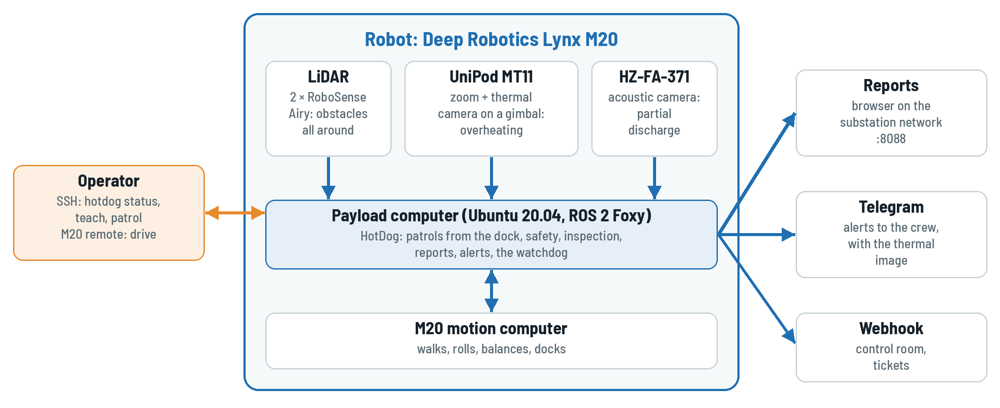
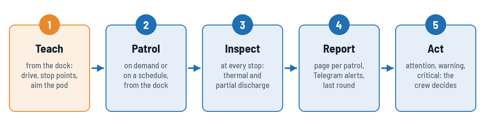
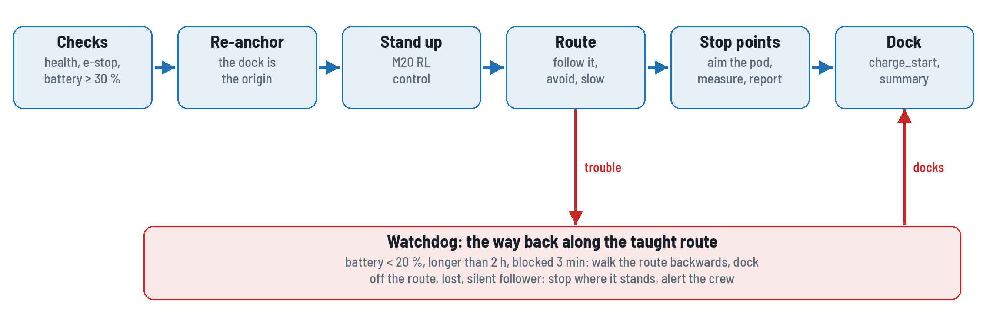

# Overview

Substation (gardu induk) equipment is inspected on fixed rounds: the same disconnectors,
busbar joints, bushings and cable terminations, every shift. HotDog walks such a round on its
own on a Deep Robotics Lynx M20, stops in front of each piece of equipment, points the pod at
it and checks it for overheating and partial discharge.

HotDog runs on **Dharma**, the shared autonomy stack, with the M20's own odometry instead of a
LiDAR-inertial estimator and without maps: routes are taught and repeated from the dock.

{.diagram}

## The robot

| Component  | Model                                           | Role                                                 |
| ---------- | ----------------------------------------------- | ---------------------------------------------------- |
| Robot base | Deep Robotics **Lynx M20** (wheel-legged)       | odometry, IMU, battery, motion (UDP protocol V1.3.0) |
| LiDAR      | 2 × RoboSense **Airy** (front, rear), 96 beams  | obstacle sectors, the 360° protective field          |
| Pod        | Reebot **UniPod MT11** (zoom + thermal, gimbal) | overheat analysis, evidence images                   |
| Acoustic   | Hertzinno **HZ-FA-371** acoustic camera         | partial discharge (corona, surface, floating)        |
| Compute    | payload computer, Ubuntu 20.04 + ROS 2 Foxy     | the whole stack                                      |

## Teach once, then patrol

{.diagram}

1. **Teach** a route once: drive it with the M20 remote from the dock, mark a stop point at
   each piece of equipment and aim the pod at it (`hotdog teach`, `hotdog aim`).
2. **Patrol** on demand (`hotdog patrol`) or at fixed times: HotDog re-anchors at the dock,
   walks the route, inspects at every stop point and docks again to charge.
3. **Read** the report at `http://<robot>:8088/` and act on the findings: attention, warning,
   critical. Warning and critical findings reach the crew's Telegram group at once.

{.diagram}

A watchdog guards every patrol: a low battery, an overlong patrol or a robot blocked for too
long sends it back to the dock along the taught route; off the route, lost or without its
follower it stops and calls the crew. It never overrules an operator's pause, the e-stop or
the M20 remote.

## Architecture

<div class="arch">

```text
                 ┌────────────────────────────────────────────────────────────────────┐
 HotDog          │ patrol_node: dock -> route -> dock, schedule, watchdog, way back   │
                 │ inspection_node: overheat (UniPod MT11), partial discharge (HZ-FA) │
                 │ report_node: pages on :8088 · alert_node: Telegram, webhook        │
                 ├────────────────────────────────────────────────────────────────────┤
 Dharma          │ path follower (stop points -> inspection hook) · avoidance         │
                 │ sites and taught routes · localization (dock = map origin)         │
                 │ sector scans · control mux (only cmd_vel, e-stop, field) · health  │
                 ├────────────────────────────────────────────────────────────────────┤
 robot           │ m20_driver: odometry camera_init -> body, IMU, battery, cmd_vel    │
                 │ cloud_merger_node: front + rear Airy -> /lidar/points              │
                 │ unipod_driver: gimbal, zoom, streams, temperatures                 │
                 └────────────────────────────────────────────────────────────────────┘
```

</div>

- **Odometry only.** The M20's own dead reckoning is the odometry, nothing is mapped; the dock
  is the origin of the map frame, re-anchored before every patrol.
- **Motion has one way out.** The control mux is the only publisher of `/m20/cmd_vel`; the
  protective field on the 360° scan of both Airy, the health speed limit and the latched e-stop
  apply to every source. m20_driver stops on its own without fresh commands.
- **Inspection never holds the patrol.** The follower calls `inspection/inspect` at each stop
  point; a stop without an inspection point, a missing pod or camera answers and the robot
  moves on; everything found is in the reports.

## Packages

| Package                                            | Role                                                                                      |
| -------------------------------------------------- | ----------------------------------------------------------------------------------------- |
| [`hotdog`](/packages/hotdog)                       | the robot: profile, M20 driver settings, stack config, `robot.launch.py`, `sim.launch.py` |
| [`hotdog_base`](/packages/hotdog_base)             | both RoboSense Airy as one leveled cloud in `base_link`, the shared launch helpers        |
| [`hotdog_inspection`](/packages/hotdog_inspection) | inspection at the stop points: overheat, partial discharge, reports, teaching             |
| [`hotdog_patrol`](/packages/hotdog_patrol)         | patrols from the dock, on demand or on a schedule, the watchdog, the way back to the dock |
| [`hotdog_reports`](/packages/hotdog_reports)       | HTML patrol reports with the last round of every finding, retention, the server on 8088   |
| [`hotdog_alerts`](/packages/hotdog_alerts)         | findings, patrols and health ERROR to Telegram and a webhook, spooled while offline       |
| [`hotdog_interfaces`](/packages/hotdog_interfaces) | findings, inspection reports and status, `AddTarget`                                      |

The stack (`dharma_*`) is pinned in
[dharma.repos](https://github.com/DarmawanRobotics/HotDog/blob/main/dharma.repos), the M20,
pod and Airy drivers in
[external.repos](https://github.com/DarmawanRobotics/HotDog/blob/main/external.repos).

## Which guide

| You                                | Read                                                                                            |
| ---------------------------------- | ----------------------------------------------------------------------------------------------- |
| operate the robot on a shift       | the [User Manual](manual/user-manual.md), then [Operations](operations.md) as a quick reference |
| bring up a new robot or substation | [Commissioning](commissioning.md), then the [Technician Guide](technician/technician-guide.md)  |
| hand a robot over to a substation  | the [Site Acceptance Test](acceptance/acceptance-test.md)                                       |
| change the code                    | the packages, [Contributing](/contributing) and the quick start below                           |

Every guide is also an A5 PDF, sized to read on a phone during a shift: the **PDF** menu above.

## Develop

```bash
git clone git@github.com:DarmawanRobotics/HotDog.git && cd HotDog
scripts/dev.sh up                     # dev container (ROS 2 Foxy, VNC): imports the repos
scripts/dev.sh build && scripts/dev.sh test
scripts/dev.sh shell
ros2 launch hotdog sim.launch.py rviz:=true          # the stack on dharma_sim, no robot
```

This site is built from `docs/` with VitePress (`cd docs && npm ci && npm run dev`); the guides
are the same Markdown as the PDFs (`python3 docs/pdf/build.py`).
